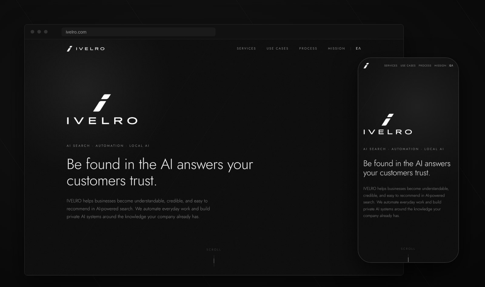
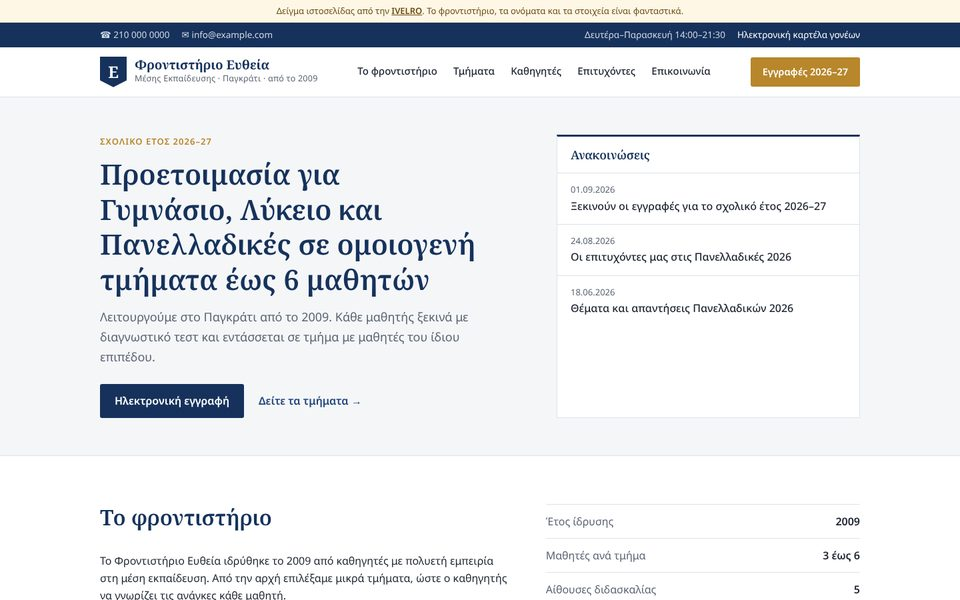
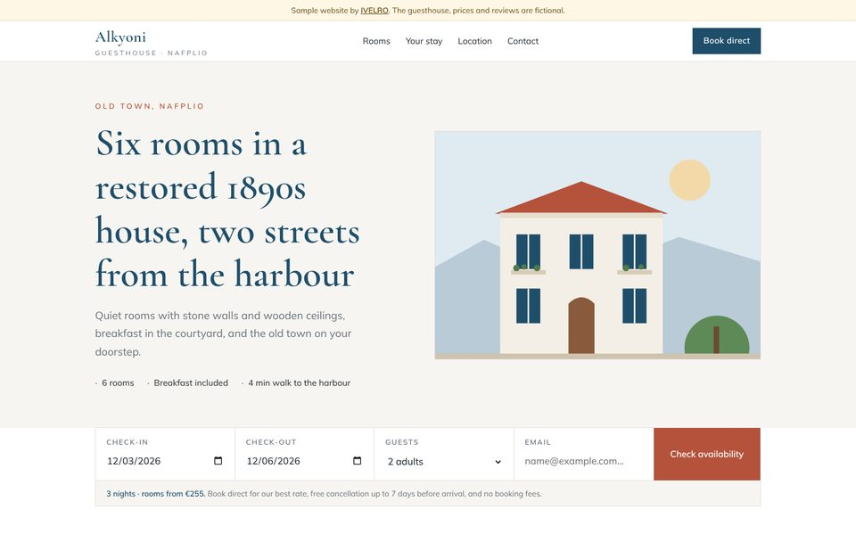
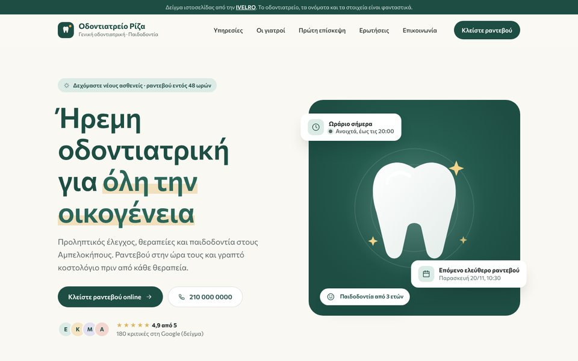
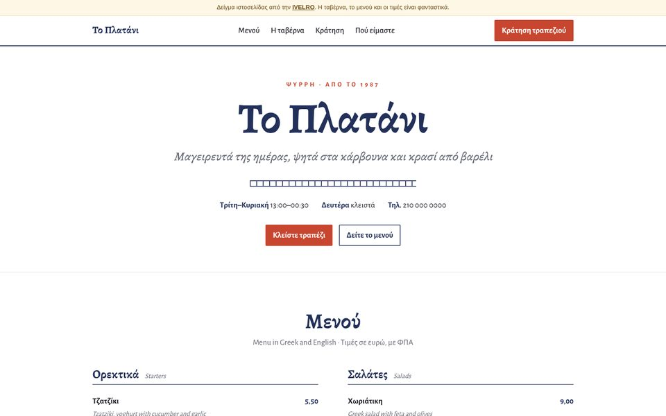

<p align="center">
  <a href="https://ivelro.com"></a>
</p>

<p align="center">
  <a href="https://ivelro.com"></a>
  <a href="https://github.com/antwnakys/ivelro/actions/workflows/pages.yml"></a>
  
  
</p>

<p align="center">
  <a href="https://ivelro.com"><b>Website</b></a>
  &nbsp;·&nbsp;
  <a href="https://ivelro.com/portfolio/"><b>Our work</b></a>
  &nbsp;·&nbsp;
  <a href="#run-it-locally"><b>Run locally</b></a>
</p>

<br>

<p align="center">
  
</p>

## About

**IVELRO** is a technology team from Athens, working with businesses of every kind and size, anywhere. We build modern websites and business automation that help businesses work more efficiently, save time on repetitive tasks and give their customers a better experience.

> *Intelligence, Simplified.*

| | What we do |
|---|---|
| **01 · Web Development & Digital Experiences** | Modern, fast websites that strengthen a business's online presence and make it easy for customers to find what they need. |
| **02 · Business Automation & AI Integration** | Automating repetitive work, connecting the tools a business already uses and bringing AI into everyday workflows. |

This repository holds the company website, [ivelro.com](https://ivelro.com), and the sample websites in our portfolio.

## Portfolio

Sample websites for four very different kinds of business. Each one includes an online form that shows how a simple automation saves the owner time. Click a preview to open the live site.

<table>
  <tr>
    <td width="50%" valign="top">
      <a href="https://ivelro.com/portfolio/frontistirio/"></a>
      <br><b>Φροντιστήριο Ευθεία</b> &nbsp;<sub>Tutoring centre · Greek</sub>
      <br><sub>Classes and exam fields, staff, results, and online signup with automatic confirmation.</sub>
    </td>
    <td width="50%" valign="top">
      <a href="https://ivelro.com/portfolio/guesthouse/"></a>
      <br><b>Alkyoni Guesthouse</b> &nbsp;<sub>Guesthouse · English</sub>
      <br><sub>Rooms and prices, a direct-booking request with a live price estimate, travel information.</sub>
    </td>
  </tr>
  <tr>
    <td width="50%" valign="top">
      <a href="https://ivelro.com/portfolio/dental/"></a>
      <br><b>Οδοντιατρείο Ρίζα</b> &nbsp;<sub>Dental practice · Greek</sub>
      <br><sub>Services, live opening hours, the first visit explained, and appointment requests with SMS confirmation.</sub>
    </td>
    <td width="50%" valign="top">
      <a href="https://ivelro.com/portfolio/taverna/"></a>
      <br><b>Ταβέρνα Το Πλατάνι</b> &nbsp;<sub>Taverna · Greek and English</sub>
      <br><sub>A bilingual menu with prices, the story of the place, and table reservations with a reminder.</sub>
    </td>
  </tr>
</table>

<sub>The businesses in the samples are fictional. Names, prices and details are illustrative.</sub>

## How it's built

- **Plain HTML, CSS and JavaScript.** No framework and no build step, so pages load fast and are easy to maintain.
- **Mobile first.** Every page is tested from 360 px phones to 1440 px desktops.
- **Accessible.** Keyboard navigation, visible focus, readable contrast, reduced-motion support and screen-reader friendly forms.
- **Search ready.** Meta tags, social preview image, `sitemap.xml` and `robots.txt`.
- **Automatic deploys.** Every push to `main` is published to GitHub Pages.

## Project structure

```
.
├── index.html               Company homepage (English)
├── el/                      Greek homepage and Greek portfolio page
├── 404.html                 Not-found page
├── assets/
│   ├── css/style.css        Site styles (colour tokens at the top)
│   ├── js/main.js           Header, reveal animations, scroll-spy
│   └── img/                 Logo, favicons, social image
├── portfolio/
│   ├── index.html           "Work" page
│   ├── frontistirio/        Sample: tutoring centre
│   ├── guesthouse/          Sample: guesthouse
│   ├── dental/              Sample: dental practice
│   ├── taverna/             Sample: taverna
│   ├── shared/sample.js     Shared menu, opening hours and form logic
│   └── img/                 Preview images for the Work page
├── signatures/              Email signatures and signature maker (not published)
├── templates/               Starter template and generator for client sites (not published)
├── staging/                 Contact section and privacy pages, ready to switch on (not published)
├── docs/                    Hosting guide, launch checklist, support package (not published)
├── sitemap.xml · robots.txt · CNAME
└── .github/workflows/pages.yml   Deploy to GitHub Pages
```

## Run it locally

No installation needed. From the project folder:

```bash
python3 -m http.server 8000
```

Then open <http://localhost:8000>.

## Deployment

The workflow in [`.github/workflows/pages.yml`](.github/workflows/pages.yml) publishes the site to GitHub Pages on every push to `main`. The site is served at **[ivelro.com](https://ivelro.com)** over HTTPS.

<details>
<summary><b>Domain and DNS settings</b></summary>
<br>

The custom domain is set by the `CNAME` file. DNS records (Cloudflare, DNS only):

| Type  | Name  | Value               |
|-------|-------|---------------------|
| A     | @     | 185.199.108.153     |
| A     | @     | 185.199.109.153     |
| A     | @     | 185.199.110.153     |
| A     | @     | 185.199.111.153     |
| CNAME | www   | antwnakys.github.io |

In **Settings → Pages**, the custom domain is `ivelro.com` with **Enforce HTTPS** turned on.

</details>

---

<p align="center">
  <picture>
    <source media="(prefers-color-scheme: dark)" srcset="assets/img/mark.png">
    
  </picture>
  <br>
  <sub>© 2026 IVELRO. All rights reserved.</sub>
</p>
